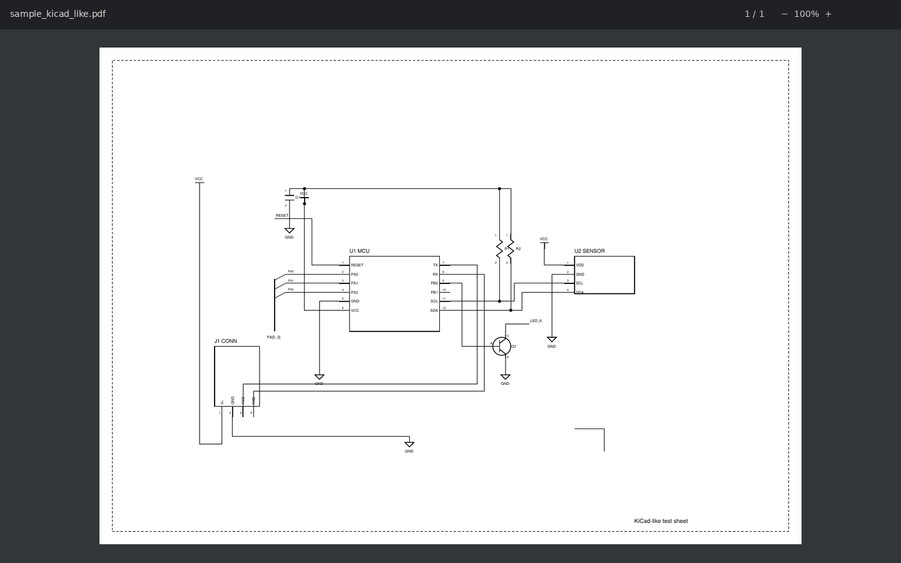
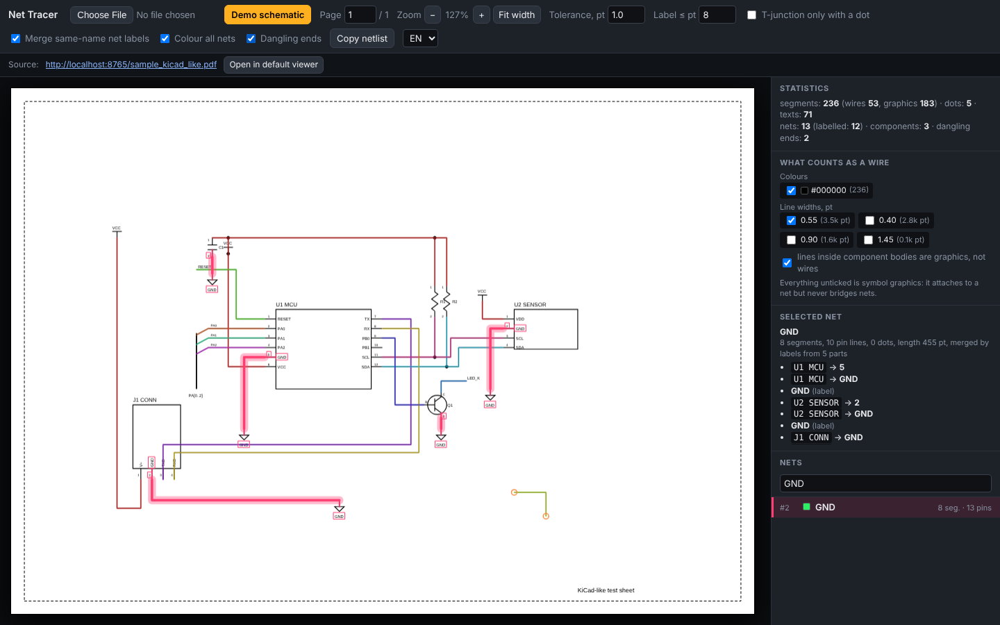
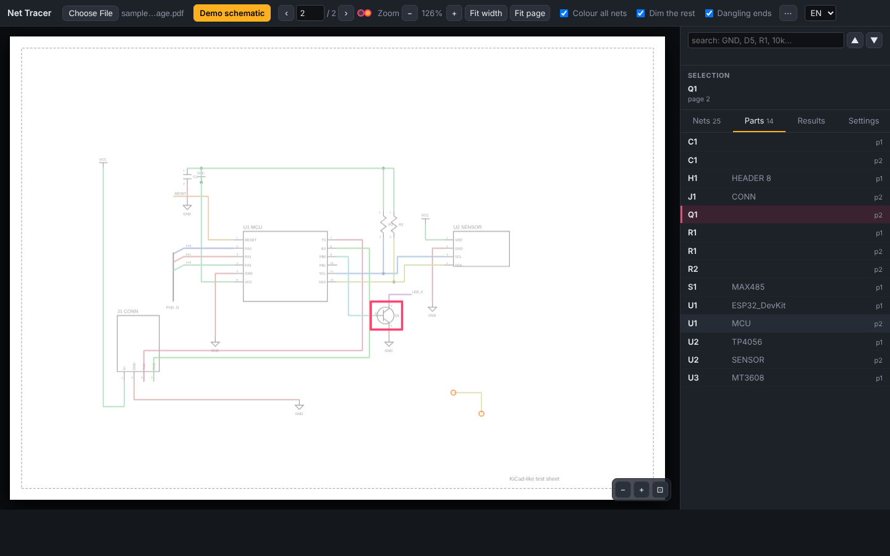
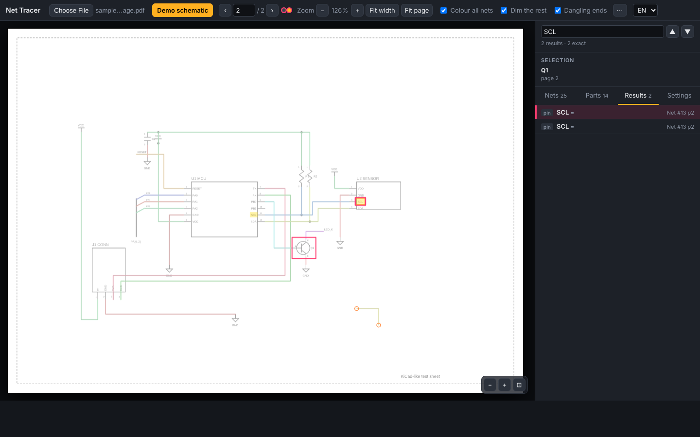
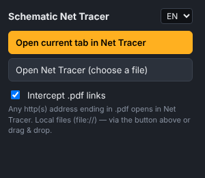

# Schematic Net Tracer

A Chrome / Edge extension that turns a plain vector PDF schematic into an interactive one: **click any wire and the whole net lights up**, together with the list of component pins it connects to. No AI, no cloud — everything runs locally in the browser on top of [pdf.js](https://mozilla.github.io/pdf.js/).

**Try it online: https://duntik.github.io/net-tracer/** (viewer: [/app/](https://duntik.github.io/net-tracer/app/)).

Built for repairing tools and boards from a schematic PDF: find where a trace goes, which pins share a net, and where a wire ends without reaching anything.

| Before — a plain PDF export, every line looks the same | After — Net Tracer, `GND` selected |
|---|---|
|  |  |

## Features

- **Click a wire → highlight its net.** The rest of the sheet dims; hover shows the net name; `Esc` clears.
- **Nets tab** — every net with its type (**PWR** / **SIG**), label count (`GND ×6`), pages, pin count and dangling-end warnings. Select a net and step through all its label positions with **◀ 1 / 12 ▶** — the current one blinks, even on another page.
- **Pin list for the selected net** — `U1 MCU → GND`, `R1 → 2`, `Q1 → E`, plus net labels on the wires.
- **Parts tab** — reference designators with values (`R5 10k`, `U4 AMS1117-3.3`), multi-unit parts grouped (`U4A`/`U4B` → `U4`), page; click to jump to the part.
- **Search everything** — net names, pin names, references, values and any printed text. Results are marked yellow on the sheet, exact matches rank first, **▲ ▼** step through them, and typing two characters already jumps to the best hit.
- **Multi-page PDFs** — every page is analysed; nets with the same label are merged across sheets; the page indicator shows dots on pages that contain the selected net.
- **Dangling ends** — wire ends that reach nothing are marked, handy for spotting broken or unfinished traces.
- **Wire vs. symbol graphics** — line colours and widths you tick count as wires; everything else (component bodies, resistor zigzags, transistor symbols, power-symbol triangles) is graphics that *attaches* to a net but never bridges two nets. Wire widths are picked automatically; override them in **Settings**.
- **Export** — nodes CSV (name, type, labels, pages, wires, pins), parts CSV (reference, value, units, page), or the netlist as text to the clipboard. CSVs are UTF-8 with BOM and formula-safe for Excel.
- **Altium “Smart PDF” bookmarks** — when the PDF carries a bookmark netlist, it is used to name and merge nets.
- **Navigation** — wheel zooms at the cursor, drag pans, pinch on touch screens, `+` `−` `0`, arrows, `PageUp`/`PageDown`, double-click to zoom in (`Shift` + double-click out).
- **Open PDFs from anywhere** — any `http(s)` link ending in `.pdf` opens in Net Tracer (toggle in the popup), right-click a link → *Open link in Net Tracer*, or open a local file via the toolbar button, drag & drop, or `Ctrl+V`.
- **Phones and tablets** — bottom-sheet panel, pinch zoom, tap to select (a chooser appears when several wires are under the finger). The web version is an installable PWA: offline after the first visit, and on Android it registers as a *Share → Net Tracer* target for PDFs.
- **English by default, Russian available** — switch with the `EN / RU` selector in the viewer or the popup.
- **Fully offline.** No network requests, no telemetry. pdf.js is bundled.

| Parts tab — `Q1` selected | Search — `SCL` across the sheet |
|---|---|
|  |  |

## Install

No install is needed for the web version — open https://duntik.github.io/net-tracer/app/ and drop a PDF in. For the extension:

Net Tracer is not in the Chrome Web Store yet, so it is installed as an unpacked extension:

1. Download `net-tracer-extension.zip` from the [latest release](../../releases/latest) and unzip it into a folder you will keep (Chrome loads the files from there — do not delete it afterwards).
2. Open `chrome://extensions` (Edge: `edge://extensions`).
3. Turn on **Developer mode** (top-right switch).
4. Click **Load unpacked** and select the unzipped `net-tracer` folder (the one containing `manifest.json`).
5. Optional, for local PDFs: open the extension's **Details** and enable **Allow access to file URLs**.

To update, download the new zip, replace the folder contents and press the reload icon on the extension card.

## Usage



- **Toolbar button → popup:**
  - *Open current tab in Net Tracer* — if the tab is a PDF, it reopens in the tracer.
  - *Open Net Tracer (choose a file)* — opens an empty viewer where you can pick, drop or paste a PDF.
  - *Intercept .pdf links* — when on, any `http(s)://…/*.pdf` navigation opens in Net Tracer instead of the built-in viewer. The *Open in default viewer* button inside the tracer lifts the interception for that one page.
- **Right-click on a link** → *Open link in Net Tracer*.
- **In the viewer:** `Ctrl` + mouse wheel zooms, `Fit width` fits the page, the page number box switches sheets.

### Side panel

- **Search** — partial match on everything printed on the sheet; the **Results** tab lists hits by kind (net, part, pin, text).
- **Selection** — the selected net's type, size, pages and pin list with the label stepper, or the selected part's reference, value and page.
- **Nets** — all nets, biggest first. Clicking a selected net again steps to its next label.
- **Parts** — references with values; click to jump.
- **Settings** — statistics and warnings (scan, outlined fonts), analysis knobs, and the wire colour/width filters.

### Tuning knobs (Settings tab)

- **Tolerance, pt** — how close two line ends must be to count as connected (default 1 pt). Raise it for sloppy exports.
- **Label ≤ pt** — how far a text may sit from a line end to be treated as its label (default 8 pt).
- **T-junction only with a dot** — require a junction dot for a wire ending on the middle of another wire (some CAD styles draw dots everywhere; others never do).
- **Merge same-name net labels** — join nets that carry identical net labels, within a page and across pages (labels inside component bodies are pin names and are never used for merging).
- **What counts as a wire** — tick the line colours and widths that carry current. Defaults: all colours; the width class with the largest total length plus any class with ≥ 25 % of it. *Lines inside component bodies are graphics* keeps a body's internal drawing from shorting its pins.

## How it works

1. **Geometry extraction.** pdf.js provides the page's operator list. Every `moveTo`/`lineTo`/`rectangle`/curve path is transformed through the current transformation matrix into page coordinates. Stroked paths become line segments (with colour and line width), small filled circles become junction dots, closed axis-aligned paths become component rectangles, thin filled rectangles become lines, and `getTextContent` provides every text run with a rotation-aware bounding box. Exact duplicate segments are dropped.
2. **Classification.** Each segment is either a *wire* (ticked colour and width, not closed, not a curve, not inside a component body) or *graphics*.
3. **Connectivity.** A union-find over wires joins segments whose ends coincide, whose end lies on another wire's interior (T-junction), or which pass through the same junction dot. Crossings without a dot stay separate. Graphics segments form their own clusters and only *attach* to the wire nets they touch — they never merge nets, so a resistor symbol does not short its two pins.
4. **Labels.** Every line end is a label anchor; a text attaches to the nearest anchor within *Label ≤ pt* (a wire just below the text wins over one above it, as CAD tools place labels above wires). Anchors on unconnected pins act as sinks so a neighbouring pin's name is not stolen; value-looking texts (`10k`, `100nF`) are never labels. Pin texts get the component name from the body rectangle they touch, or from a reference designator (`R1`, `C1`, `Q1`…) found next to a body-less symbol. Same-name net labels outside bodies merge nets, within and across pages; power names are recognised by pattern (`GND`, `VCC`, `+3.3V`, `PP5V_S0`…).
5. **Parts.** References come from body name lines (`U1  ESP32_DevKit`), from reference texts beside body-less symbols, and from any remaining `R12`-looking text outside bodies; the value is the nearest unattached text in the same orientation, numbers preferred.
6. **Dangling ends.** A wire end with no partner segment, no dot, no attached graphics and no label is reported as dangling.

## Limitations

- **Vector PDFs only** — exports from EasyEDA, KiCad, Altium, Eagle etc. Scanned or rasterised PDFs have no lines to read.
- If the exporter converted text to outlines, pin and net labels are unavailable (nets still work).
- Symbols drawn with the same colour and line width as wires cannot be told apart automatically; untick the width class or rely on component bodies.
- Across sheets only same-name labels are followed; hierarchical sheet ports and off-page references without a shared name are not.
- `file://` URLs cannot be intercepted automatically in Manifest V3 — open local files via the popup button, drag & drop or paste.

## Try it

Three synthetic test schematics are in [`samples/`](samples): an EasyEDA-style coloured sheet, a black-and-white KiCad-style sheet with power symbols, body-less symbols and one deliberately dangling wire, and a two-page file combining both. The viewer also has a **Demo schematic** button that generates a two-page sheet in the browser.

## Repository layout

```
extension/          the unpacked Chrome extension (zip this folder, or take the release zip)
  manifest.json     Manifest V3
  js/background.js  .pdf interception (declarativeNetRequest), context menus, one-shot bypass
  js/viewer.js      PDF parsing, net building, rendering, UI
  js/i18n.js        EN / RU strings
  viewer.html, popup.html, js/popup.js
  sw.js, manifest.webmanifest   PWA service worker (offline cache, Android share target) — used by the web build only
  lib/              pdf.js 4.10, jsPDF (demo only), demo.js
  _locales/         store name/description
samples/            test PDFs
docs/               screenshots
.github/workflows/  release.yml builds the zip on every v* tag; pages.yml deploys the site
web/                landing page and privacy policy for GitHub Pages (the viewer is copied from extension/)
```

## License

MIT — see [LICENSE](LICENSE).
